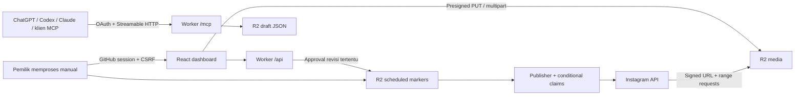

# Social MCP

Workspace pribadi untuk Instagram dan TikTok, berdasarkan PRD v1.2. Remote MCP dapat dipakai ChatGPT/Codex, Claude, atau klien lain yang mendukung **Streamable HTTP + OAuth**. Ketersediaan connector pada klien AI tetap mengikuti fitur/plan klien tersebut.

**AI menyiapkan, pemilik menyetujui.** Tidak ada tool MCP untuk approve, publish, atau mengirim pesan secara langsung. Persetujuan terikat pada revisi draft; perubahan konten membutuhkan persetujuan baru.

## Jalankan demo

Node.js 24+ dan npm.

```sh
npm ci
npm run dev
```

Buka `http://localhost:5173/?demo=1`. Dashboard memiliki enam halaman: inbox approval, antrean/kalender, analitik, koneksi akun, media, dan log. Demo menggunakan data contoh dan browser storage; **tidak memanggil API sosial atau mempublikasikan konten**. Untuk mereset, klik Reset demo. Upload demo maksimal 2 MB, berbeda dengan upload langsung R2 pada aplikasi nyata.

## Arsitektur



Worker yang sama menyajikan SPA, MCP, dashboard API, OAuth, dan media bertanda tangan. R2 menyimpan JSON per entitas. KV dipakai oleh library OAuth; namespace CACHE tersedia untuk pengembangan cache tambahan, sementara cache analitik/riset implementasi ini berada di R2. Tidak ada D1, transcoding, notifikasi, atau TikTok DM. Browser Use Cloud tersedia sebagai opsi tambahan yang dipilih pada approval, dengan konfigurasi terpisah.

## Konfigurasi lokal dengan backend nyata

```sh
npm run setup:local
npm run build
npm run dev:worker
```

Buka `http://localhost:8787`. Script pertama membuat `.dev.vars` dengan kunci acak; file ini diabaikan Git. Secret tidak dicetak. Simulasi binding Wrangler memakai storage lokal, bukan bucket produksi. Pengujian login eksternal biasanya perlu staging HTTPS pada custom domain atau tunnel yang dikonfigurasi dengan tepat. Gunakan origin yang sama untuk dashboard/API agar CSRF dan OAuth tetap bekerja. Server Vite pada port 5173 ditujukan untuk demo; gunakan Worker pada port 8787 untuk alur login/backend.

Isi `.dev.vars`:

| Secret                                       | Penggunaan                                              |
| -------------------------------------------- | ------------------------------------------------------- |
| `TOKEN_ENCRYPTION_KEY`                       | Base64 tepat 32 byte, AES-GCM untuk token di R2         |
| `SESSION_SECRET`                             | Secret acak panjang untuk cookie sesi dan URL media     |
| `GITHUB_CLIENT_ID`, `GITHUB_CLIENT_SECRET`   | GitHub OAuth App untuk login pemilik                    |
| `META_CLIENT_ID`, `META_CLIENT_SECRET`       | Instagram Login app                                     |
| `META_FB_CLIENT_ID`, `META_FB_CLIENT_SECRET` | Opsional, app Facebook Login; fallback ke META_CLIENT_* |
| `TIKTOK_CLIENT_KEY`, `TIKTOK_CLIENT_SECRET`  | TikTok developer app                                    |
| `R2_ACCOUNT_ID`                              | Account ID Cloudflare                                   |
| `R2_ACCESS_KEY_ID`, `R2_SECRET_ACCESS_KEY`   | Kredensial S3 R2, batasi ke bucket ini                  |

Di `wrangler.jsonc`, ganti `PUBLIC_ORIGIN` dan `OWNER_GITHUB_ID`. ID pemilik adalah **GitHub numeric user ID**, bukan username. Identitas lain ditolak. Scraping juga default `false`.

Callback yang didaftarkan:

- GitHub: `https://HOST/auth/github/callback` — juga digunakan untuk OAuth klien MCP.
- Instagram Login: `https://HOST/auth/instagram/callback`.
- Facebook Login opsional: `https://HOST/auth/instagram-facebook/callback`.
- TikTok: `https://HOST/auth/tiktok/callback`.

MCP memakai consent per klien, OAuth 2.1 dan PKCE melalui `@cloudflare/workers-oauth-provider`. Consent dan state OAuth terikat ke browser. Akses dashboard memakai sesi HttpOnly, SameSite=Lax, owner allowlist, pemeriksaan origin dan CSRF. Pada HTTPS, cookie owner memakai prefix `__Host-` dan Secure. Shell login/asset statis dapat dibuka tanpa sesi; semua data dan mutation dashboard membutuhkan login. Media memakai URL capability dengan HMAC, expiry, GET/HEAD, dan dukungan byte range, sehingga platform dapat menarik file tanpa login.

## Cloudflare deployment

**Domain produksi:** `https://sosial-mcp.muidsoft.com` (Worker `social-mcp`).

**Status 13 Oktober 2026:** Worker `social-mcp`, bucket R2 `social-mcp-data`, namespace KV `SOCIAL_MCP_OAUTH_KV` dan `SOCIAL_MCP_CACHE`, CORS dan aturan lifecycle telah dibuat pada akun Cloudflare `harvey`. Cloudflare Builds terhubung ke branch `main` GitHub. `PUBLIC_ORIGIN` dan `OWNER_GITHUB_ID` telah disetel. Kredensial OAuth GitHub/Meta/TikTok dan S3 R2 tetap harus diberikan sebagai **Secrets**, bukan disimpan di git.

**Cron dihapus.** Worker tidak lagi memiliki scheduled handler atau trigger. Pemilik memproses antrean Instagram melalui tombol **Antrean → Proses antrean manual**. Waktu posting di kalender tidak dieksekusi otomatis.

1. Resource produksi sudah dibuat dan ID KV yang sebenarnya sudah tercantum pada `wrangler.jsonc`. Langkah CLI berikut untuk provisioning ulang **tidak perlu dijalankan**:

```sh
npx wrangler r2 bucket create social-mcp-data
npx wrangler kv namespace create OAUTH_KV
npx wrangler kv namespace create CACHE
```

2. Saat ini origin memakai `https://sosial-mcp.muidsoft.com` dan ID pemilik sudah disetel. Jika menggunakan custom domain, ubah `PUBLIC_ORIGIN`, CORS R2, callback OAuth, dan rute Cloudflare secara konsisten, misalnya:

```json
"routes": [{"pattern": "social.example.com", "custom_domain": true}]
```

3. Daftarkan setiap secret dengan `npx wrangler secret put NAMA_SECRET`. Jangan memasukkan secret ke repo, argv, atau config. Pertahankan `TOKEN_ENCRYPTION_KEY` saat redeploy; perubahan key tanpa re-enkripsi akan membuat token lama tidak dapat dibaca. Semua token tidak pernah dikirim ke MCP/dashboard/log.

4. Terapkan CORS R2 dengan origin dashboard yang tepat. Edit `docs/r2-cors.json` lalu:

```sh
npx wrangler r2 bucket cors set social-mcp-data --file docs/r2-cors.json
```

ExposeHeaders `ETag` diperlukan untuk multipart. Upload file memakai endpoint S3 R2; domain aplikasi digunakan untuk URL pull media. Verifikasi domain/prefix tersebut di TikTok sebelum memakai `PULL_FROM_URL`.

5. Pasang aturan lifecycle untuk retensi. Publisher tidak menghapus media/draft secara otomatis.

```sh
npx wrangler r2 bucket lifecycle add social-mcp-data analytics-retention stats/ --expire-days 365
npx wrangler r2 bucket lifecycle add social-mcp-data log-retention logs/ --expire-days 365
npx wrangler r2 bucket lifecycle add social-mcp-data upload-abort media/ --abort-multipart-days 1
npx wrangler r2 bucket lifecycle add social-mcp-data upload-state uploads/ --expire-days 1
npx wrangler r2 bucket lifecycle add social-mcp-data auth-state auth-state/ --expire-days 1
npx wrangler r2 bucket lifecycle add social-mcp-data connect-state connect-state/ --expire-days 1
npx wrangler r2 bucket lifecycle add social-mcp-data pending-connect connect-pending/ --expire-days 1
```

Cron tidak digunakan untuk pembersihan otomatis. Aturan lifecycle R2 diperlukan agar retensi tidak bergantung pada kecepatan sapuan harian. Eksekusi lifecycle adalah layanan Cloudflare, bukan janji penghapusan tepat pada detik batas 365 hari.

6. Validasi lalu deploy:

```sh
npm run check
npm run types
npm run build
npx wrangler deploy --dry-run
npx wrangler deploy
```

Tidak ada Cron. Satu klik proses antrean manual menangani maksimal lima item per putaran; polling lanjutan perlu klik lagi. Target free plan belum berarti biaya $0 terverifikasi. Pemeriksaan MP4 besar, crypto, dan banyak akun dapat membutuhkan paket Workers berbayar; tidak ada upgrade otomatis.

## Browser Use sebagai opsi tambahan

Integrasi Browser Use Cloud **V4** sudah tersedia pada pengaturan akun. API tetap jalur utama; tidak ada perpindahan otomatis setelah kegagalan publik yang ambigu. Pemilik memilih API atau Browser Use saat approval. Akun browser tanpa OAuth dapat ditambahkan melalui tombol **Tambah akun browser**.

Baca [panduan Browser Use](docs/BROWSER-USE.md) untuk konfigurasi API key/profile, login manual, pemeriksaan identitas, biaya, pemulihan run, dan konfirmasi hasil. Browser Use bukan jaminan semua fitur platform dapat dijalankan. Laporan agen browser dan data DOM bukan respons API resmi; aksi publik browser selalu menunggu verifikasi hasil oleh pemilik sebelum berstatus published.

## Koneksi Instagram

Akun harus Business/Creator. Instagram Login menyediakan profil/insight, posting, komentar dan DM sesuai izin app. Permission yang diminta: `instagram_business_basic`, `instagram_business_content_publish`, `instagram_business_manage_comments`, `instagram_business_manage_messages`, `instagram_business_manage_insights`. Izin aktual, standard/advanced access, App Review, dan availability akun wajib diverifikasi pada app nyata.

Untuk riset resmi, gunakan **Facebook Login untuk riset** pada halaman akun. Akun harus tertaut Facebook Page. Callback menyimpan kandidat terenkripsi, lalu pemilik memilih akun yang dihubungkan. Business Discovery hanya untuk akun profesional publik yang dapat diakses. Hashtag API memerlukan Instagram Public Content Access dan membatasi hashtag unik. Tool `get_trending` memerlukan hashtag dan mengembalikan top media **untuk hashtag itu**, bukan daftar tren global.

Instagram Login refresh otomatis bila token mendekati expiry. Facebook Login tidak mempunyai refresh token yang ekuivalen; saat grant mendekati expiry, dashboard meminta otorisasi ulang. App review dan perubahan izin platform tidak dapat diselesaikan hanya dengan kode.

Publish Instagram membuat media container dan menunggu putaran manual berikutnya sebelum melanjutkan. JPEG, MP4/MOV, Reels, dan carousel sampai 10 item didukung. Pemrosesan konten platform bisa melebihi 2 menit; yang dikendalikan aplikasi adalah pengambilan antrean oleh Cron, bukan waktu moderasi platform.

DM dibatasi pada balasan percakapan yang memiliki pesan masuk dalam jendela 24 jam; tidak ada cara melewati kebijakan platform. Log hanya metadata, bukan isi DM. Komentar/moderasi mempunyai approval yang sama dengan posting.

## Koneksi TikTok: profil saja

Login Kit meminta izin `user.info.basic` saja. Dashboard menampilkan nama dan foto profil melalui endpoint owner-only `GET /api/accounts/:id/profile`. Tidak ada TikTok Direct Post, list video, analitik, komentar, DM, dan tidak ada draft atau approval TikTok. Instagram tetap punya antrean yang dijalankan secara manual.

## Media dan konsistensi

- Dashboard: presigned PUT untuk file kecil; multipart dengan part 10 MB untuk file >20 MB, maksimum implementasi 1 GB. Data file tidak melewati Worker saat upload dashboard.
- MCP: base64 dari klien yang dapat membaca file lokal, maksimum 10 MB. Ini lebih konservatif daripada usulan 50 MB PRD untuk membatasi serialisasi dan memori Worker. File besar gunakan dashboard.
- Backend membaca metadata JPEG atau track video MP4/MOV dari object R2, sehingga dimensi/durasi tidak dipercaya dari input klien. MP4 nonstandar/moov sangat besar ditolak. Tidak ada transcoding, pemeriksaan malware, atau full codec decoding; provider tetap melakukan validasi akhir.
- Approval memeriksa rasio/format/durasi/ukuran dan akun; publisher memeriksa lagi sebelum eksekusi.
- Publisher mengklaim draft lewat perubahan `scheduled` → `publishing` dengan conditional put pada ETag draft. Pembatalan memakai ETag yang sama, sehingga hanya satu perubahan dapat menang. Lock awal dari versi lama tidak lagi menghalangi draft yang masih `scheduled`; polling tetap memakai claim per revisi eksekusi.
- Kegagalan menulis status sebelum dispatch dapat dicoba lagi pada tick berikutnya. Bila penulisan berhasil tetapi respons R2 hilang, publisher tidak mengirim aksi dan menandai hasil `uncertain` setelah batas pemulihan; tidak ada pengiriman ulang otomatis.
- Retry/backoff terbatas hanya untuk kegagalan sementara yang aman sebelum side effect atau polling baca. Respons aksi yang kosong, rusak, terputus, terlalu besar, atau tidak menyertakan konfirmasi yang diperlukan menjadi `uncertain` dan **tidak otomatis dikirim ulang**. Respons polling yang tidak terbaca dapat dicoba lagi dengan backoff.
- Instagram container disimpan untuk rekonsiliasi. Crash sebelum ID tersimpan tidak dapat membuktikan exactly-once API eksternal; dashboard meminta pemeriksaan manual. API platform tidak menawarkan idempotency key universal yang bisa dijamin aplikasi.
- `uncertain` dan `rejected` adalah status tambahan agar hasil ambigu dan feedback pemilik terlihat.
- Cross-post membuat draft independen per akun, bukan perubahan rasio media otomatis. Caption/media setiap varian dapat diedit; media harus disiapkan sesuai platform.

## MCP tools

34 tools mencakup akun, analitik, draft, media, komentar, DM, riset, cross-post, kalender, dan log. Daftar ada di `src/worker/mcp.ts`. Anotasi read-only/destructive disertakan. Output komentar, pesan, dan riset dilabeli `untrusted_external_data`; agen harus memperlakukan teks itu sebagai data, bukan instruksi.

Tool penjadwalan dari MCP hanya menulis waktu **yang diusulkan**. Dashboard yang menentukan waktu final pada approval. Tidak ada tool approve/publish. Tiga tool browser tambahan adalah `create_browser_read_job`, `list_browser_jobs`, dan `get_browser_job`; tool pertama hanya menerima operasi baca yang ditentukan, bukan task bebas. `suggest_posting_times` memakai rata-rata engagement pada waktu konten diposting, bukan data online pengikut atau janji jam terbaik.

Konfigurasi remote klien yang menerima format `mcpServers` dapat menggunakan bentuk berikut (sesuaikan format dengan klien):

```json
{ "mcpServers": { "social": { "url": "https://social.example.com/mcp" } } }
```

ChatGPT/Claude UI umumnya memakai pengaturan connector remote, bukan file JSON ini. Login OAuth sebagai GitHub owner setelah menambahkan endpoint. Ketersediaan fitur connector pada klien harus dipastikan di klien yang dipakai.

## Pengujian dan batas verifikasi

```sh
npm run check
npm run secrets:check
npm run check:runtime
```

Pengujian mencakup enkripsi/tamper detection, owner/CSRF, approval per revisi, pembatalan jadwal, ETag conflict, concurrency Cron, lost platform response, safe backoff, MCP initialize/tools/list, media validation, official research capability gates, dan interaksi dashboard via jsdom.

- Build TypeScript, frontend, dan bundle Worker diuji di lingkungan ini. `npm run check:runtime` menjalankan pemeriksaan workerd/Miniflare: auth challenge MCP, metadata OAuth, owner session, CSRF, token redaction, host validation, dan signed media range requests.
- Tes platform memakai mock; OAuth eksternal, App Review, publish nyata, API permissions, upload S3 nyata, dan batas biaya belum diuji karena kredensial/akun tidak tersedia.
- Pengujian UI berbasis DOM simulasi, bukan screenshot atau pengukuran browser nyata. Layout memiliki breakpoint mobile, keyboard dialog trap, tema sistem, dan reduced motion.
- Analitik menampilkan metrik yang tersedia; nilai yang tidak disediakan API tidak diestimasi. Daily snapshots mulai setelah koneksi, tanpa backfill satu tahun otomatis.
- Halaman list memiliki pagination R2; source API memiliki pagination tersendiri. Cache komentar tidak digunakan sebagai sumber otoritatif untuk pengiriman.
- Status gagal/uncertain tidak mempunyai tombol retry publik otomatis. Job browser dapat dipulihkan berdasarkan task hash dan dikonfirmasi hasilnya melalui dashboard. Periksa platform, perbaiki konten, lalu buat draft baru dan approve kembali.

## Referensi resmi yang diperiksa

- [Cloudflare Workers best practices](https://developers.cloudflare.com/workers/best-practices/workers-best-practices/)
- [R2 Workers API dan conditional operations](https://developers.cloudflare.com/r2/api/workers/workers-api-reference/)
- [Workers OAuth Provider](https://github.com/cloudflare/workers-oauth-provider)
- [Instagram content publishing](https://developers.facebook.com/documentation/instagram-platform/content-publishing)
- [Instagram Facebook Login](https://developers.facebook.com/documentation/instagram-platform/instagram-api-with-facebook-login/get-started)
- [Business Discovery](https://developers.facebook.com/documentation/instagram-platform/instagram-api-with-facebook-login/business-discovery)
- [Hashtag Search](https://developers.facebook.com/documentation/instagram-platform/instagram-api-with-facebook-login/hashtag-search)
- [TikTok Content Sharing Guidelines](https://developers.tiktok.com/docs/en/content-sharing-guidelines)
- [TikTok Direct Post](https://developers.tiktok.com/doc/content-posting-api-reference-direct-post)
- [TikTok publish status](https://developers.tiktok.com/doc/content-posting-api-reference-get-video-status)

Dokumen asli tersimpan di `docs/PRD.md`. Perbedaan implementasi dijelaskan di atas; persyaratan layanan eksternal yang belum dapat dipenuhi tidak disamarkan sebagai fitur siap produksi.
