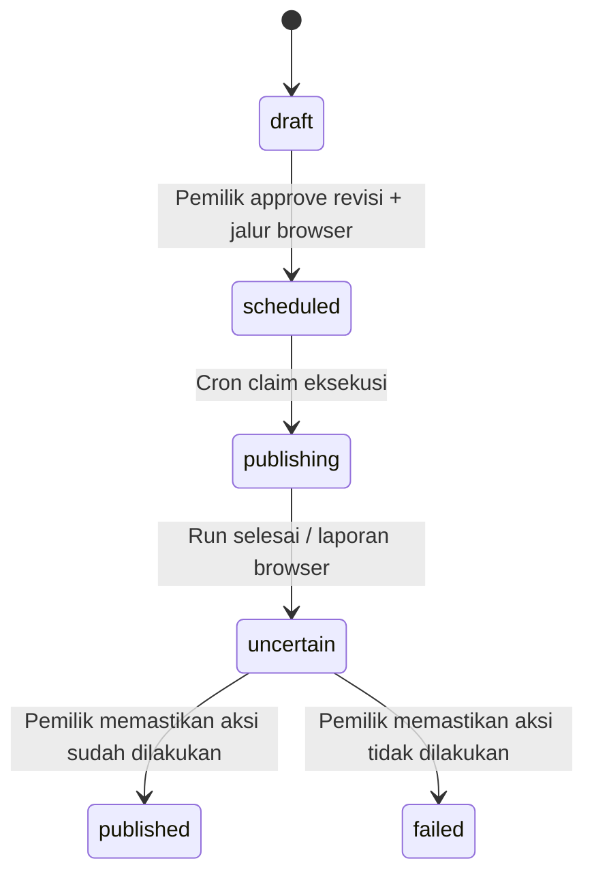

# Browser Use — opsi tambahan

Integrasi ini memakai **Browser Use Cloud API V4** melalui HTTPS dari Cloudflare Worker. Tidak perlu menjalankan Chromium di Worker atau menyediakan VPS Python. Layanan Browser Use menjalankan browser/agen di infrastrukturnya sendiri. API resmi Instagram/TikTok tetap tersedia.

Ini implementasi kode dan pengujian lokal. API key, profile login, kredit Browser Use, akun sosial, dan deployment produksi belum tersedia dalam sesi pengerjaan; tidak ada task Browser Use berbayar atau posting nyata yang dijalankan.

## Setup

1. Buat project/API key di Browser Use Cloud. Buat **satu profile untuk setiap akun sosial** di dashboard Profiles. Profile menyimpan cookie/local storage login; jangan gunakan profile bersama untuk akun lain.
2. Simpan API key sebagai Worker Secret:

```sh
npx wrangler secret put BROWSER_USE_API_KEY
```

Untuk lokal, isi `.dev.vars` yang diabaikan Git. `npm run setup:local` membuat template baru tanpa menimpa secret yang sudah ada. Jangan menaruh key/cookie/password pada caption, chat, source, atau dashboard form.

3. Gunakan deployment HTTPS dengan `PUBLIC_ORIGIN` yang dapat diakses layanan Cloud; URL localhost/private untuk media ditolak sebelum dispatch. Edit vars `wrangler.jsonc`:

```json
"BROWSER_USE_ENABLED": "true",
"BROWSER_USE_MAX_COST_USD": "0.50",
"BROWSER_USE_MAX_RUNS_PER_DAY": "20"
```

Default integrasi **nonaktif**. `maxCostUsd` dikirim pada request run; ini pembatas dari provider, bukan jaminan batas total tagihan yang keras. Browser/hosting/network dapat ditagih terpisah. Batas lokal 20 start per hari juga menghitung sesi login dan probe, memakai conditional writes R2. Counter berganti pada 00:00 UTC (07:00 WIB). Tidak ada auto top-up atau upgrade yang dikonfigurasi oleh aplikasi.

4. Build, periksa, deploy seperti README utama. Buka **Akun terhubung → Pengaturan browser**. Isi Profile UUID dan **handle akun yang harus cocok**. Display name TikTok dari API bisa berbeda; masukkan handle asli, bukan nama tampilan. Handle/profile yang berubah membatalkan binding approval lama.
5. Klik **Buka sesi login**. Link live browser hanya dikirim ke dashboard pemilik. Login ke situs platform secara manual; selesaikan password/2FA/verifikasi sendiri. Link memberi akses ke sesi: jangan dibagikan. Sesi login mempunyai timeout 10 menit. Setelah selesai, klik **Tutup sesi & simpan**, lalu **Periksa identitas**.
6. Job probe memeriksa akun yang benar-benar sedang login melalui account menu/profile milik sesi, bukan hanya membuka public profile dengan nama yang cocok. Tunggu hasil sampai koneksi berstatus `ready`. Ini tetap merupakan observasi agen; setiap task kembali diminta memeriksa identitas sebelum bertindak.

Bila API belum tersedia, **Tambah akun browser** membuat metadata akun tanpa mengklaim token API valid. Analytics/API untuk akun tersebut tidak dianggap tersedia; gunakan job baca browser untuk data yang terlihat.

## Alur aksi publik



- Pilih **Browser Use (opsi tambahan)** saat approval dan setujui penggunaan layanan secara eksplisit. Ganti jalur mereset checkbox persetujuan.
- Approval terikat pada revisi draft dan revisi koneksi browser. Klien MCP tidak dapat memilih approval route, menyetujui, atau memulai public browser task secara langsung.
- Media tervalidasi di R2. Browser mengunduh URL media yang ditandatangani saat dispatch, lalu memakai file itu pada UI platform. Batas kebijakan aplikasi untuk jalur browser: **50 MB per file**; file besar gunakan jalur API. Tidak ada transcoding, revisi caption otomatis, atau penambahan hashtag oleh agen.
- Caption, media, jenis, privasi TikTok, disclosure komersial, dan pilihan interaksi dikirim sebagai kontrak literal yang sudah disetujui. Bila UI tidak dapat mewakili opsi itu, agen diminta berhenti, bukan menebak.
- Balasan/moderasi memerlukan URL posting tepat, author, dan teks komentar asli. DM Instagram memerlukan URL thread dan username penerima; agen diminta memastikan pesan masuk terakhir masih dalam 24 jam. Tidak ada TikTok DM.
- Public final click hanya boleh sekali. Ketika hasil belum jelas, task harus berhenti dan melaporkan ketidakpastian. Aplikasi menahan **semua laporan public action** untuk pemeriksaan pemilik, termasuk laporan sukses dari agen.
- Buka **Antrean → Periksa browser** atau detail job pada halaman Akun. Periksa langsung platform. Klik **Aksi sudah dilakukan** atau **Aksi tidak dilakukan** setelah memastikan run selesai. Tombol ini tidak mengirim konten baru.

Durasi browser/unggahan/moderasi tidak dapat dijamin ≤2 menit. Approval per akun tetap berlaku pada cross-post. Kegagalan satu varian tidak membatalkan yang lain.

## Job baca tambahan

Pada halaman Akun terdapat form **Browser Use · pekerjaan tambahan**. Pilih akun, jenis baca, dan target bila diperlukan. Hasil di detail job dilabeli **source=browser**, **untrusted_external_data**, dan waktu observasi. Nilai statistik yang tidak terlihat tetap `null`, bukan angka estimasi atau nol palsu. Data ini tidak otomatis mengganti cache analitik resmi.

Jenis yang tersedia: statistik terlihat, daftar konten, komentar satu posting, daftar percakapan IG, pesan thread IG, serta profil/hashtag publik. Maksimal 25 item per hasil. Dari hasil komentar/pesan, pemilik dapat membuat draft balasan dan meneruskannya ke approval biasa.

Tools MCP tambahan:

- `create_browser_read_job`: argumen tetap `account_id`, `kind`, `target_url`, `username`, `hashtag`; asinkron dan berbayar. Tidak menerima task bebas atau operasi publish.
- `list_browser_jobs`: metadata saja.
- `get_browser_job`: hasil baca yang telah divalidasi. Tidak mengembalikan cookie, profile ID, CDP/live-view URL, task internal, atau payload terenkripsi.

## Konsistensi dan recovery

- Satu lease R2 per hash profile membatasi pekerjaan/sesi bersamaan. Lease tidak habis otomatis ketika hasil dispatch tidak diketahui. Perubahan koneksi ditolak selama lease aktif.
- Job public punya ID deterministik per draft/revisi dan record dispatch sebelum POST ke Browser Use. Cloud V4 tidak diasumsikan memiliki idempotency key yang tidak didokumentasikan.
- Timeout/malformed response/HTTP 5xx saat create berarti **uncertain**. Tidak ada redispatch otomatis atau fallback dari API setelah public error yang ambigu.
- Profile sibuk sebelum dispatch boleh menunggu antrean dengan retry terbatas, karena belum ada public task yang dikirim untuk draft itu. Ini berbeda dari mengulang public task yang mungkin sudah dijalankan.
- Jika respons create hilang, lihat Browser Use Cloud, ambil **run UUID**, lalu gunakan **Cocokkan & pulihkan**. Backend hanya menerima run yang `task`-nya memiliki hash tepat sesuai kontrak tersimpan; run milik pekerjaan lain ditolak.
- Bila tidak ada run ID, pemilik dapat menutup dispatch ambigu **hanya setelah memeriksa Cloud dan platform serta memastikan tidak ada run aktif**. Ini melepaskan lease dan menandai failed; tidak memulai ulang. Pengakuan manusia ini tidak dianggap bukti exactly-once dari provider.
- Sesi login dengan respons hilang dapat dipulihkan menggunakan browser UUID. Metadata `socialJob` dan `socialAccount` harus cocok sebelum browser dapat dihentikan oleh aplikasi.
- Polling memakai queue aktif dan maksimal dua job per Cron; tidak memindai semua job historis. Retry-After dihormati. Run yang teridentifikasi dan melewati 10 menit diminta cancel; cancel bukan bukti aksi belum terjadi.
- Setelah terminal, aplikasi menghentikan browser milik agent session sebelum lease dilepas. `cleanupPending` tetap terlihat bila penghentian gagal; profile tidak boleh dipakai ulang sampai cleanup berhasil. Mematikan feature flag menolak task baru, tetapi status/cancel/stop task lama tetap dapat dipanggil selama API key masih ada.

Prefix R2 tambahan: `browser/jobs/`, `browser/pending/`, `browser/leases/`, `browser/logins/`, `browser/poll-claims/`, dan `browser/budget/`. Profile dan payload kontrak disimpan AES-GCM. Hasil baca dapat memuat pesan pribadi milik pemilik; log aktivitas hanya metadata. Jangan menerapkan lifecycle yang menghapus lease/job ambigu secara otomatis. Aturan aman opsional:

```sh
npx wrangler r2 bucket lifecycle add social-mcp-data browser-poll-retention browser/poll-claims/ --expire-days 2
npx wrangler r2 bucket lifecycle add social-mcp-data browser-budget-retention browser/budget/ --expire-days 30
```

## Batas keamanan dan kelayakan

Kontrak task, whitelist jenis baca, validasi URL/output, correlation hash, account binding, dan approval diterapkan oleh aplikasi. **Instruksi read-only/domain pada agen Cloud bukan sandbox kemampuan browser yang dapat dibuktikan oleh Worker.** Agen browser tetap probabilistik dan konten halaman dapat mengandung prompt injection. Tidak tepat menjanjikan agen tidak pernah melakukan tindakan yang tidak diinginkan hanya karena prompt menyuruhnya membaca. Untuk kebutuhan isolation yang keras, diperlukan runner terpisah dengan tool/network enforcement; itu bukan bagian dari adapter Cloud ini.

Hasil agen bukan respons resmi platform. Caption, komentar, pesan, dan profil eksternal tetap data tidak tepercaya. Konfirmasi manusia setelah public run merupakan bagian dari desain tambahan ini, bukan klaim bahwa task berhasil hanya karena provider melaporkan `completed`.

Task diminta berhenti pada CAPTCHA, 2FA, login challenge, atau pembatasan platform. Aplikasi tidak menyediakan solver, proxy rotation, pemalsuan identitas, ataupun workflow untuk menghindari App Review/ketentuan platform. Layanan cloud mungkin mempunyai perilaku browser tersendiri; review layanan dan ketentuan platform sebelum mengaktifkannya. Browser Use tidak membuat penggunaan otomatis yang dilarang menjadi diizinkan.

Konten/metadata yang dikirim pada task serta browser session diproses di Browser Use Cloud. Jangan berasumsi rekaman off berarti layanan tidak menyimpan trace/screenshot internal. Kredensial/profile/billing dan kebijakan retensi layanan harus diperiksa pada akun provider. Cloud V4 memiliki fitur dan batas berbeda dari OSS Python `browser-use`; aplikasi ini tidak menjalankan OSS runner lokal.

## Verifikasi

Tes lokal mencakup approval route, profile binding, dispatch ganda, concurrency lease, batas start, response loss/recovery, receipt hash/akun, challenge, cleanup, queue aktif, owner confirmation, serta UI demo. Workerd smoke checks memverifikasi endpoint tetap di belakang owner session/CSRF. Tes provider memakai mock; belum ada task Cloud berbayar, login platform nyata, atau publish end-to-end yang dijalankan.

Referensi API yang diperiksa saat implementasi:

- [Create Run V4](https://docs.browser-use.com/cloud/api-v4/runs/create-run)
- [Get Run V4](https://docs.browser-use.com/cloud/api-v4/runs/get-run)
- [Profiles](https://docs.browser-use.com/cloud/guides/authentication)
- [Human in the loop](https://docs.browser-use.com/cloud/agent/human-in-the-loop)
- [Browser sessions](https://docs.browser-use.com/cloud/api-v4/browsers/list-browser-sessions)
- [Billing](https://docs.browser-use.com/cloud/guides/billing)
